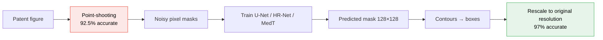

<div align="center">

# Sketched Image Segmentation

**Segmenting technical drawing figures in US patents — a heuristic method and four deep learning models compared.**

[](https://ceur-ws.org/Vol-3164/)
[](https://www.python.org/)
[](https://pytorch.org/)
[](https://keras.io/)
[](https://www.lanl.gov/)

[Problem](#-the-problem) · [Method](#-methods) · [Results](#-results) · [Data](#-data) · [Usage](#-usage) · [Citation](#-citation)

</div>

---

## 📌 The problem

A patent drawing sheet usually holds several subfigures, each with its own label, caption and reference text. Before any of that can be linked up — before a system can say *this* caption describes *this* drawing — the sheet has to be cut into its individual figures.

Standard approaches don't transfer. Rule-based figure extractors built for research-paper PDFs assume compound figures separated by background colour or clean layout. Sweeping-line methods that scan for rows and columns of low ink density break on patent sheets for two reasons: stray components like figure labels interrupt the whitespace, and a single drawing is often made of several disconnected parts. Deep learning detectors trained on natural images don't transfer either — patent drawings are sparse black-on-white line art with almost none of the texture, colour or shading those models rely on.

So this work builds a method for the actual data, and benchmarks it against the strongest general-purpose alternatives.

**Work done during an internship at Los Alamos National Laboratory**, with Dr. Diane Oyen (LANL) and Dr. Jian Wu (ODU).

---

## 🎯 Methods

### Point-shooting (the heuristic)

Named for how it works: it throws darts at the drawing and keeps the ones that land on ink.

```
1. Remove figure labels
2. Pick a pixel, draw an open circle of radius r
3. Ink detected inside the circle?  keep it  :  discard it
4. Fill every surviving circle
5. Extract contours over the filled region
6. Fit rectangular bounding boxes to the contours
```

The insight is in step 4. Line art is mostly whitespace, so ordinary connected-component analysis shatters a single drawing into dozens of unconnected strokes. Filling a disc around every ink pixel bridges those gaps, so each drawing collapses into one solid blob and contour detection recovers its extent. Circle centres are constrained to stay inside the figure boundary.

Cheap, interpretable, no training — and it gets **92.5%** of subfigures right.

> The paper uses r = 2. The scripts here ship with a larger default radius; it's the main knob to tune, and the right value depends on stroke density and image resolution.

### Deep learning models

Point-shooting fails on certain layouts, so four learned models were benchmarked against it:

| Model | Type | Why it's here |
|---|---|---|
| **U-Net** | CNN, encoder–decoder | The standard segmentation baseline. Skip connections carry some high-resolution detail across the bottleneck. |
| **HR-Net** | CNN, multi-resolution | Keeps high- and low-resolution streams alive throughout instead of downsampling then recovering. Simplified here to three channels of five, three and two conv blocks. |
| **MedT** | Transformer, gated axial attention | Designed for small datasets — gating controls how much relative positional encoding influences non-local context. Global branch over the whole image, local branch over patches. |
| **DETR** | Transformer, end-to-end detection | Predicts boxes directly, no NMS or custom layers. Fine-tuned from the 80-class model. |

### The interesting part: training on labels you know are wrong

There's a mismatch in the data. Ground truth is **bounding boxes**, drawn by hand. U-Net, HR-Net and MedT are semantic segmentation models that need **pixel-level masks**. The annotations can't train them directly.

The fix: run point-shooting over the training figures and use its output as the masks. Those labels are knowingly noisy — the labeller is only 92.5% accurate.



**The students beat the teacher.** MedT trained on point-shooting's noisy output reaches 97%, against the 92.5% of the method that generated its labels. The networks learn the underlying structure rather than memorising the labeller's mistakes — a clean, small-scale demonstration of learning from weak supervision.

Inputs are rescaled to 128×128 to cut compute. Predicted masks come back at 128×128×3, get converted to contours and boxes, and the boxes are linearly scaled up to the original resolution.

---

## 📊 Results

200 held-out figures. A segmentation counts as correct when IoU against the ground-truth box exceeds 0.7. Runtime is total seconds for all 200 figures.

| Model | Automatic accuracy | Manual verification | Runtime |
|---|---:|---:|---:|
| Point-shooting | 92.5% | 92.5% | 1,035 s |
| U-Net | 90.5% | 91.5% | **15 s** |
| HR-Net | 96.0% | 96.5% | 18 s |
| **MedT** | **97.0%** | **97.0%** | 29 s |
| DETR | 90.0% | 91.0% | 1,396 s |

Manual inspection agreed with automatic evaluation **98%** of the time, so the IoU threshold is a fair proxy here.

**What the numbers say.** MedT wins on accuracy and is cheap to run — 29 seconds for 200 figures. HR-Net trails it by a point, which is attributable to gated attention capturing long-range pixel relationships that convolution cannot; a single patent drawing can span the sheet, so a model that only sees local neighbourhoods is at a structural disadvantage. Keeping high-resolution streams alive also matters: HR-Net beats U-Net by 5.5 points, and boundary precision is exactly what a segmentation-to-bounding-box pipeline depends on.

DETR underperforms and is the slowest thing in the table — 1,396 seconds, worse than the untrained heuristic. Direct box prediction fine-tuned from an 80-class natural-image detector doesn't adapt well to sparse line art on this data volume.

Point-shooting is competitive on accuracy but slow, since it evaluates a circle per candidate pixel. It earns its place as a label generator, not as the production method.

### Where everything fails

The consistent failure mode is a subfigure made of **isolated fragments**, which every method treats as separate objects. Some single-subfigure sheets defeat all five models for this reason. Fixing it needs a notion of figure grouping that none of these approaches has.

<!-- TODO: add a qualitative comparison strip (input | point-shooting | U-Net | HR-Net | MedT | DETR)
     as assets/qualitative.png — Figure 4 of the paper. Visual results carry this repo more
     than any table does. -->

---

## 💾 Data

Sourced from the **United States Patent and Trademark Office (USPTO)**, design patent category.

| Property | Value |
|---|---|
| Figures | 500 randomly selected |
| Single-drawing files | 20 |
| Multi-subfigure files | 480 |
| Subfigures per file | 2–12 |
| Evaluation set | 200 figures |
| Annotation tool | [VGG Image Annotator (VIA)](https://www.robots.ox.ac.uk/~vgg/software/via/) |

Text labels are stripped during preprocessing. The number of subfigures per sheet is inferred from the count of detected text labels, so segmentation only runs where there is more than one. Every bounding box went through independent human verification.

This benchmark was released with the paper for future work on technical drawing segmentation.

```
Data/                              dataset pointers
Transformer-MedT/train_folder/     img/ + labelcol/ — training pairs
Transformer-MedT/val_folder/       img/ + labelcol/ — validation pairs
Transformer-MedT/Images_100/       100-image evaluation subset
Pre-trained Models/                trained weights (see read.md for the Drive link)
```

---

## ⚡ Usage

### Setup

```bash
git clone https://github.com/reshadshuvo123/Sketched-Image-Segmentation.git
cd Sketched-Image-Segmentation
pip install opencv-python numpy matplotlib tensorflow keras torch torchvision
```

Input and output paths are hard-coded at the top of each script — edit them before running.

### 1. Point-shooting

```bash
# Bounding boxes + cropped subimages
python point-shooting-method-sketched-images.py

# Boxes, subimages, and coordinates
python Point-shooting-bounding-box-roi-coordinates.py

# Boxes from contours only
python Point-shooting-Method-sketced-image-contour-extractino.py
```

### 2. U-Net and HR-Net

```bash
python U-Net-Segmentaion.py     # train U-Net
python HR-Net.py                # train HR-Net
python UNet-HR-Net-testing.py   # inference
python model-evalution.py       # IoU evaluation against ground-truth boxes
```

### 3. MedT

Clone [Medical-Transformer](https://github.com/jeya-maria-jose/Medical-Transformer) and copy `testing_transformer.py`, `test_ex.py` and `testing_transformer_ex.py` from `Transformer-MedT/` into it.

```bash
python train.py \
  --train_dataset "<train dir>" \
  --val_dataset   "<val dir>" \
  --direc         "<results dir>" \
  --modelname "gatedaxialunet" \
  --batch_size 4 --epoch 400 --save_freq 10 \
  --learning_rate 0.001 --imgsize 128 --gray "no"
```

Testing runs in two steps — `testing_transformer.py` generates and resizes the point-shooting ground truth alongside the originals, then evaluation runs against it.

### 4. DETR

Fine-tuning notebook: [Google Colab](https://colab.research.google.com/drive/1cUsMNYNmzp06H6wEDpqj5Tt2ZCGtedLe?usp=sharing)

---

## 📝 Citation

```bibtex
@inproceedings{hoque2022segmenting,
  title     = {Segmenting Technical Drawing Figures in US Patents},
  author    = {Hoque, Md Reshad Ul and Wei, Xin and Choudhury, Muntabir Hasan and
               Ajayi, Kehinde and Gryder, Martin and Wu, Jian and Oyen, Diane},
  booktitle = {Proceedings of the AAAI-22 Workshop on Scientific Document
               Understanding (SDU@AAAI 2022)},
  series    = {CEUR Workshop Proceedings},
  volume    = {3164},
  pages     = {1--6},
  year      = {2022}
}
```

A LANL mirror of this code is maintained at [GoFigure-LANL/figure-segmentation](https://github.com/GoFigure-LANL/figure-segmentation).

## 👤 Author

**Md Reshad Ul Hoque** — PhD, Electrical & Computer Engineering, Old Dominion University
ORCID: [0000-0003-4055-2582](https://orcid.org/0000-0003-4055-2582)

[](https://scholar.google.com/citations?user=_uefhgUAAAAJ&hl=en)
[](https://www.linkedin.com/in/reshadshuvo123/)
[](https://github.com/reshadshuvo123)

## 📄 License

Portions of this work were produced under U.S. Government contract 89233218CNA000001 for Los Alamos National Laboratory, operated by Triad National Security, LLC for the U.S. Department of Energy / National Nuclear Security Administration. See the header of `model-evalution.py` for the full notice.

`Transformer-MedT/` contains third-party code from [Medical-Transformer](https://github.com/jeya-maria-jose/Medical-Transformer) under its own license.
